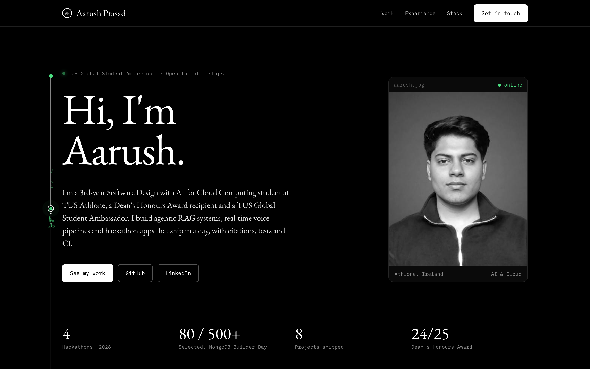
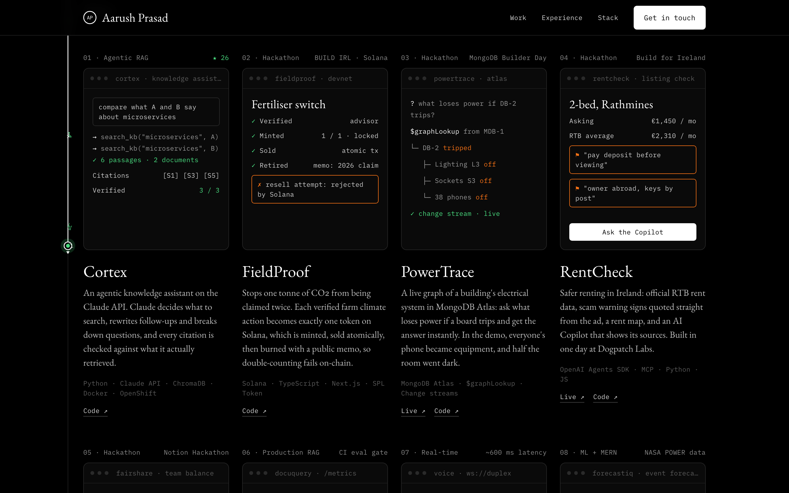
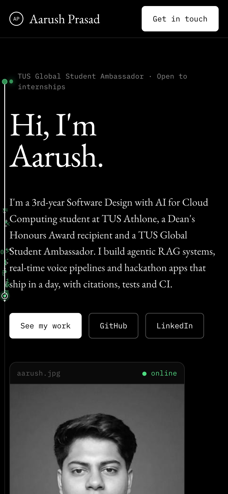

<div align="center">


# Aarush Prasad · Portfolio

**AI, cloud and hackathon builds by a 3rd-year Software Design student at TUS Athlone, Ireland.**

[](https://aarushprasad.vercel.app)
[](https://aarush310.github.io)


<br/>

<a href="https://aarushprasad.vercel.app">
  
</a>

</div>

---

## ✨ Highlights

- **A route that follows you down the page.** A white line draws itself as you scroll, with a glowing "agent" dot on its tip that leaves a trail of code glyphs. It swings across the page between sections and lights a node at each one.
- **Projects shown as small working screens.** Each card has a hand-built mock of the app: a tool-calling trace for Cortex, a Solana token lifecycle for FieldProof, a `$graphLookup` power tree for PowerTrace.
- **One file, zero dependencies.** Everything lives in [`index.html`](index.html): no framework, no bundler, no `node_modules`. The only external requests are Google Fonts.
- **Built for phones too.** Single-column layout under 700px, 35px+ tap targets, a smaller route that stays clear of the text, and no sideways scrolling.
- **Respects reduced motion.** With *Reduce motion* turned on, the glyph trail, pulsing and fade-ins are switched off and the line simply tracks your scroll.

<table>
  <tr>
    <td width="68%"></td>
    <td width="32%"></td>
  </tr>
  <tr>
    <td align="center"><sub><b>Selected work.</b> Eight projects, each with its own mock interface.</sub></td>
    <td align="center"><sub><b>On a phone.</b> Same design, one column.</sub></td>
  </tr>
</table>

## 🗂️ What's on the site

| Section | What it shows |
|---|---|
| **Hero** | Intro, portrait, and stats: 4 hackathons in 2026, picked as one of 80 from 500+ applicants, 8 projects shipped, Dean's Honours Award 2024–25 |
| **Selected work** | Eight projects with live demo and code links |
| **Where I've been** | TUS Global Student Ambassador, hackathons and Dublin AI Week, BSc (Hons), certifications |
| **The stack** | Languages, AI & LLMs, frameworks, cloud & ops |
| **Contact** | Email, LinkedIn and GitHub |

### Featured projects

| Project | What it is | Built with |
|---|---|---|
| [**Cortex**](https://github.com/Aarush310/cortex-knowledge-assistant) | Agentic RAG on the Claude API with verified citations | Python · Claude API · ChromaDB |
| [**FieldProof**](https://github.com/HimanshuBaheti/FieldProof) | Farm climate actions as single-use Solana tokens that can't be double-counted · *BUILD IRL Vol. 1* | Solana · TypeScript · Next.js |
| [**PowerTrace**](https://github.com/Aarush310/PowerTrace) · [live](https://powertrace-embs.onrender.com) | Live dependency graph of a building's power system · *MongoDB × Give(a)Go Builder Day* | MongoDB Atlas · `$graphLookup` |
| [**RentCheck**](https://github.com/Aarush310/Rentcheck) · [live](https://rentcheck-psi.vercel.app) | Rental-scam checker grounded in official RTB data · *Build for Ireland* | OpenAI Agents SDK · MCP |
| [**Fairshare**](https://github.com/Aarush310/FairShare) | AI planner that keeps group projects fair · *Notion Loves Dublin Hackathon* | React 19 · TypeScript · PWA |
| [**DocuQuery**](https://github.com/Aarush310/docuquery) | Production RAG with hybrid retrieval and an eval gate in CI | FastAPI · Prometheus |
| [**Voice**](https://github.com/Aarush310/voice-assistant) | Real-time STT → LLM → TTS pipeline over one WebSocket | FastAPI · Groq · Cartesia |
| [**ForecastIQ**](https://github.com/Aarush310/ForecastIQ) | Event-specific weather forecasts with a Random Forest model | MERN · scikit-learn |

## 🧭 How the scroll route works

The animation is about 150 lines of plain JavaScript at the bottom of `index.html`.

1. **Build the path from the layout.** On load and on every resize, it reads where the hero dot and each section heading sit, then writes one SVG path: straight runs down the margin, joined by cubic Bézier S-curves that swing across the gap between sections.
2. **Map scroll position to path length.** It samples the path every 6px into a lookup table of *length → y*, so each scroll can binary-search the length whose point sits 62% of the way down the viewport.
3. **Draw and ease.** `stroke-dashoffset` reveals the line up to that length. The dot eases toward it based on elapsed time, so it keeps pace on slow devices too, and rotates to follow the curve.
4. **Leave a trail.** A fixed `<canvas>` spawns small fading glyphs (`0 1 { } < > /`) behind the dot as it moves, capped at 220 at a time.

The idea comes from the route animation on [feena.dev](https://feena.dev). This version is written from scratch.

## 📁 Project structure

```
.
├── index.html            # the whole site: markup, styles, scripts
├── favicon.svg           # tab icon (the route's agent dot)
├── favicon.ico           # fallback icon for older browsers
├── apple-touch-icon.png  # iOS home-screen icon
├── docs/                 # README screenshots
└── .vercelignore         # keeps docs and local files out of the deploy
```

## 🚀 Run it locally

No install needed. Serve the folder with anything static:

```bash
python3 -m http.server 8000
```

Then open <http://localhost:8000>.

## ☁️ Deployment

| Where | URL | How it updates |
|---|---|---|
| **Vercel** (primary) | [aarushprasad.vercel.app](https://aarushprasad.vercel.app) | Automatically on every push to `main` |
| **GitHub Pages** (mirror) | [aarush310.github.io](https://aarush310.github.io) | Deployed from the [`Aarush310.github.io`](https://github.com/Aarush310/Aarush310.github.io) repo |

Vercel Web Analytics loads only on the Vercel domain.

## 🎨 Make it yours

- **Photo:** add `photo.jpg` next to `index.html`. Until then the page falls back to the GitHub avatar.
- **Colours:** every colour is a CSS variable in `:root` at the top of `index.html`. Change `--accent` to recolour the dot, nodes and trail.
- **Route:** the sections the line visits, and which side it runs on, are set in one array inside `build()`.

## 📬 Contact

**Aarush Prasad** · Athlone, Ireland

[](https://aarushprasad.vercel.app)
[](https://www.linkedin.com/in/aarush-prasad/)
[](mailto:aarushprasad33@gmail.com)
[](https://github.com/Aarush310)

<sub>Typeset in EB Garamond and IBM Plex Mono.</sub>
